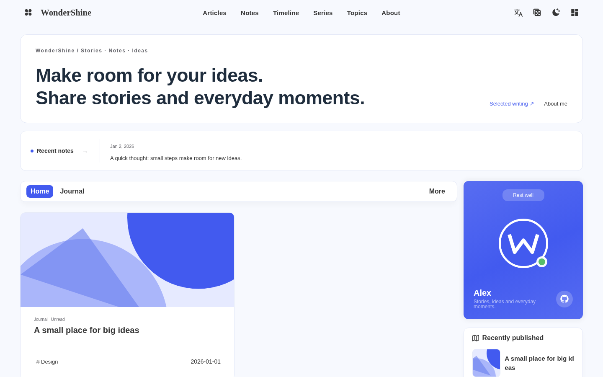
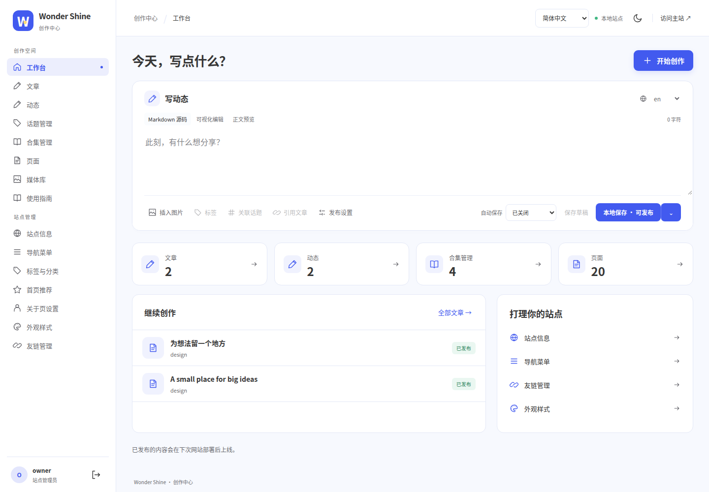

<p align="center">
  
</p>

<h1 align="center">WonderShine</h1>

<p align="center">用文章记录思考，用动态分享日常。<br>Astro 静态博客主题，搭配独立的 WonderShine Studio 创作中心。</p>

<p align="center">
  <a href="https://www.npmjs.com/package/@wondershine/theme"></a>
  <a href="LICENSE"></a>
</p>

<p align="center">
  <a href="docs/getting-started.md"><strong>从零搭建</strong></a> ·
  <a href="docs/migration.md">从 Zola 迁移</a> ·
  <a href="#wondershine-studio">创作中心</a> ·
  <a href="docs/configuration.md">配置指南</a>
</p>



*真实示例站截图；文章、作者与插图均为演示内容。*

## 一处写作，多种表达

- **文章与动态**：长文、短消息和文章引用，共同出现在时间线中。
- **内容有组织**：用标签、分类、话题和系列连接内容，保留各自的用途。
- **多语言创作**：文章与动态可拥有不同语言版本，主题界面与导航也支持国际化。
- **轻量浏览**：静态输出、站内无刷新切换，以及构建时生成的 AVIF / WebP 多尺寸图片。

内容保存在你的 Markdown、TOML 和图片文件中。主题升级不会覆盖站点的 `content/`、`public/`、`config.toml` 或 `data*.toml`。

## 先运行示例

需要 **Node.js ≥ 22.23.4**、npm 和 Git。在新目录中执行：

```sh
git clone https://github.com/iWangJiaxiang/Astro-Theme-WonderShine.git
cd Astro-Theme-WonderShine
npm ci
npm run dev
```

打开终端显示的地址即可浏览 Demo。它适合体验和开发主题；自己的内容请放在独立站点中。

**准备建站？** 按 [从零搭建](docs/getting-started.md) 复制最小 Starter，再从 npm 安装已发布的 `@wondershine/theme`。已有 Zola 站点可按 [迁移指南](docs/migration.md) 转换内容并核对旧链接。

主题通过 Astro Integration 接入，Starter 已包含这份配置：

```js
import { defineConfig } from 'astro/config';
import wondershine from '@wondershine/theme';

export default defineConfig({
  integrations: [wondershine()],
});
```

## WonderShine Studio

在同一个创作中心写文章、发动态、管理图片与译文。支持 Markdown 源码、可视化编辑和预览；连接 OpenAI-compatible API 后，可生成摘要、封面和待审核的翻译。



| 使用方式 | 适合的场景 |
| --- | --- |
| 浏览器本地服务 | 编辑电脑上的站点，配合 Astro 预览 |
| 自建服务 / 云函数 | 在线管理 Git 内容仓库 |
| 桌面 App | 选择本地 Git 仓库，或下载远程仓库后离线创作 |
| 移动 App | 下载远程仓库后编辑，或连接自建 Studio 服务 |

在仓库根目录启动浏览器版：

```sh
npm run setup -w @wondershine/studio
npm run studio:dev
```

Setup 中选择你的独立站点目录，并设置登录账号。App 的本地保存、Git 提交与同步分别操作；在线 Git 模式的保存行为见 [工作区说明](docs/studio-workspaces.md)。

博客本身是静态站，Studio 是独立应用。修改内容后，线上博客仍需重新构建部署。App 的平台条件与限制见 [Studio apps](docs/studio-apps.md)。

## 按需阅读

| 你想做什么 | 从这里开始 |
| --- | --- |
| 新建博客，发布第一篇文章 | [从零搭建](docs/getting-started.md) |
| 保留 Zola 内容与历史链接 | [迁移指南](docs/migration.md) |
| 调整导航、页面与多语言内容 | [配置与内容格式](docs/configuration.md) · [导航配置](docs/configuration.md#导航配置) |
| 配置动态、引用和订阅 | [动态与订阅](docs/configuration.md#动态与订阅) |
| 更新已有 Astro 博客的主题 | [主题升级与回退](docs/upgrading.md) |
| 部署博客或创作中心 | [部署指南](docs/deployment.md) |
| 了解保存、分支与同步 | [工作区说明](docs/studio-workspaces.md) |

评论、搜索、音乐与 AI 的外部服务需要另外配置。样式可用 `public/css/custom.css` 覆盖；组件和布局支持显式导入，暂不提供 Tera 模板继承或同路径自动替换。

<details>
<summary><strong>参与开发</strong></summary>

| 目录 | 内容 |
| --- | --- |
| `packages/theme/` | Astro Integration、页面、组件、配置与主题资源 |
| `apps/studio/` | React 创作中心、服务端适配与 Tauri App |
| `examples/starter/` | 最小站点模板 |
| `examples/demo/` | 示例站点 |
| `docs/` | 使用与架构文档 |

常用验证入口：

```sh
npm run check
npm test
npm run test:integration
npm run test:package
npm run audit:distribution
```

`npm run build` 构建 Demo，`npm run build:starter` 构建 Starter。App 构建与平台验收由 GitHub Actions 执行。

</details>

## 许可与致谢

采用 **[AGPL-3.0-or-later](LICENSE)**。原主题与第三方代码来源见 [NOTICE.md](NOTICE.md)。
